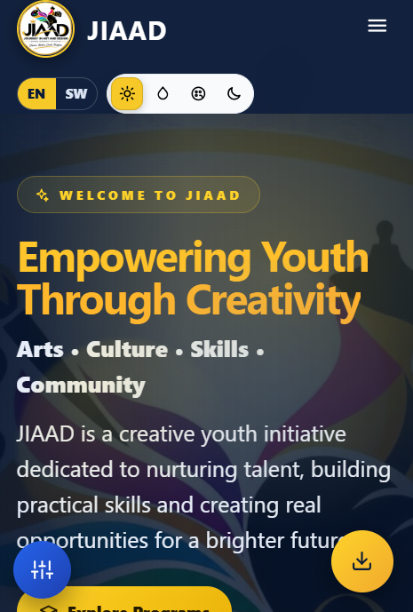

<p align="center">
  
</p>

# JIAAD Foundation

**A creative youth platform connecting people with programmes, skills and opportunities.**

[Visit the live website](https://jiaadfoundation.co.ke) · [Explore programmes](https://jiaadfoundation.co.ke/programs.php) · [Developer profile](https://github.com/obash11)

## Overview

JIAAD — **Journey in Art and Design** — is a Mukuru community initiative supporting young people through creativity and practical skills. I built the JIAAD Foundation website to give that work an accessible online home, bringing programme information, registration entry points and community resources into one place.

**Developer:** [Obadiah Otwori](https://github.com/obash11)<br>
**Live domain:** [jiaadfoundation.co.ke](https://jiaadfoundation.co.ke)<br>
**Repository type:** Project showcase — documentation and screenshots, not application source code.

[Case study](#case-study) · [Feature guide](#public-feature-guide) · [Preview](#mobile-preview) · [Demo routes](#guided-demo-routes) · [FAQ](#frequently-asked-questions) · [Feedback](#feedback-and-contributions)

## Case study

**The need:** A community initiative needs one clear place to introduce its programmes, help new learners find a starting point and direct returning students to their sign-in page.

**The approach:** Organise the public experience around discovery, joining and staying connected. Programme information, registration links, opportunities and community stories sit within a shared navigation system.

**The design focus:** A recognisable visual identity, prominent calls to action and display/language controls that give visitors choices in how they browse.

**The delivered work:** A live website at the Foundation's domain, with the public sections described below. This case study describes the experience rather than claiming measured enrolment or employment outcomes.

## Public feature guide

| # | Feature | What visitors can find |
| --- | --- | --- |
| 1 | Programme catalogue | Creative and practical learning tracks with descriptions |
| 2 | Track filters | Controls for narrowing the homepage programme list |
| 3 | Quick programme search | A text field for finding a programme in the list |
| 4 | Path Finder | An entry point for exploring a learning direction |
| 5 | Registration | A public page for starting a membership application |
| 6 | Student sign-in | A dedicated login entry point for returning students |
| 7 | Certificate verification | A public certificate-checking page |
| 8 | Opportunities | A section for jobs, internships and scholarships |
| 9 | Community updates | Events, news, alumni stories and gallery sections |
| 10 | Language choices | English and Swahili controls |
| 11 | Theme choices | Light, sepia, blue and night display controls |
| 12 | Accessibility controls | An accessibility-options entry point |

These entries describe the public interface. Protected student/admin areas are not part of this showcase.

## Mobile preview

<p align="center">
  <a href="https://jiaadfoundation.co.ke"></a>
</p>

<sub>Screenshot captured from the public website on 12 November 2026. The announcement was dismissed in the browser for this view. The live page may change.</sub>

## Project focus

- Give young people a clear starting point for discovering creative learning opportunities.
- Bring programme information and student access together in a consistent experience.
- Present the initiative's work through community news, events and resources.

## Explore the website

- [Programmes](https://jiaadfoundation.co.ke/programs.php)
- [Path Finder](https://jiaadfoundation.co.ke/pathfinder.php)
- [Registration](https://jiaadfoundation.co.ke/register.php)
- [Certificate verification](https://jiaadfoundation.co.ke/verify.php)
- [Opportunities](https://jiaadfoundation.co.ke/opportunities.php)

## Guided demo routes

| Visitor | Suggested route |
| --- | --- |
| New learner | [Home](https://jiaadfoundation.co.ke) → browse programmes → try a track filter → explore the registration page |
| Returning student | Home → Student Portal → view the sign-in entry point |
| Community visitor | [Opportunities](https://jiaadfoundation.co.ke/opportunities.php) → explore available categories → browse news or alumni stories |
| Portfolio reviewer | Explore the homepage layout → switch display themes → review the public programme and certificate pages |

Use public pages for a portfolio tour. Do not create test student accounts, submit false applications or try to access protected areas.

## Frequently asked questions

<details>
<summary><strong>Is the application source code included?</strong></summary>

No. This repository documents the live project. It does not distribute the production application or its database.

</details>

<details>
<summary><strong>Is this the project previously called JIAAD Portal?</strong></summary>

Yes. It is showcased here as **JIAAD Foundation**, at `jiaadfoundation.co.ke`. Some live page labels still use “JIAAD Creative Youth Portal”.

</details>

<details>
<summary><strong>Where should programme or membership enquiries go?</strong></summary>

Use the Foundation's live website. GitHub issues are for feedback on the website/showcase, not student admissions or private support requests.

</details>

<details>
<summary><strong>Can I try a demo student or administrator account?</strong></summary>

No demo credentials are published here. Review the public pages instead; private accounts and student records remain outside the showcase.

</details>

## Feedback and contributions

[Report a website/showcase issue](https://github.com/obash11/jiaad-foundation/issues/new?template=bug_report.yml) · [Suggest an improvement](https://github.com/obash11/jiaad-foundation/issues/new?template=improvement.yml)

Read the [contribution guide](CONTRIBUTING.md) and [privacy/security reporting guidance](SECURITY.md) before sharing screenshots or reports.

### Check the documentation locally

With Node.js 18 or newer installed, run this command from the repository folder:

```sh
node .github/scripts/check-showcase.cjs
```

The checker validates local document/image links, presentation assets, issue-form JSON/YAML and permitted file types. It does not test the live application's business workflows.

## Repository scope

This is a **portfolio showcase**, not an installable release or an open-source copy of the production system. It contains documentation, presentation assets and a documentation-checking utility. Production application code, database exports, credentials and student records are not included.

---

Built by **[Obadiah Otwori](https://github.com/obash11)**. Also explore **[Setmore Creatives Hub](https://github.com/obash11/setmore-creatives-hub)**.
